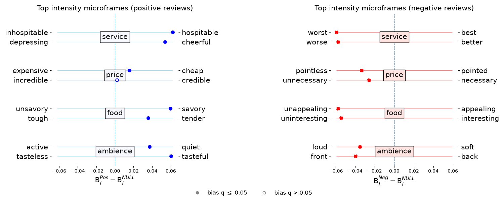

# frameaxis

a repository for "FrameAxis: characterizing microframe bias and intensity with word embedding" 
https://peerj.com/articles/cs-644/



The two highest-intensity microframes for each aspect of the SemEval-2014 restaurant reviews (notebook 4, from `reference/semeval14/`), each placed at its microframe bias against the null model, B<sub>f</sub><sup>Pos</sup> − B<sub>f</sub><sup>NULL</sup> for positive and B<sub>f</sub><sup>Neg</sup> − B<sub>f</sub><sup>NULL</sup> for negative reviews; a hollow marker means that bias is not significant (BH q > 0.05).
Figure 1B of the PeerJ paper carries the same axis labels but plots the difference between positive and negative reviews, B<sub>f</sub><sup>Pos</sup> − B<sub>f</sub><sup>Neg</sup>, which no test covers (#23). The side each review group leans to is the same except for credible – incredible in positive price reviews, whose bias against the null is not significant; the magnitudes differ (cheap – expensive, for example, is 0.015 against the null and 0.049 between the two groups). One microframe also changed with the corrected test in #13: the second one for negative price reviews is now necessary – unnecessary instead of uninspiring – inspiring.

**Install**

Requires Python 3.11 to 3.13 (CI tests both; gensim has no wheels for 3.14 yet). Everything runs in NumPy; TensorFlow is no longer needed, and the `*_with_tf` method names are kept only for compatibility.

With pip, which installs the latest versions of the dependencies:

```
python3.11 -m venv .venv
source .venv/bin/activate
pip install -e ".[examples,dev]"
python -c "import nltk; nltk.download('stopwords')"
```

Or with [uv](https://docs.astral.sh/uv/), which installs the exact versions in `uv.lock` that CI tests (and downloads Python 3.11 if needed):

```
uv sync --python 3.11 --extra examples --extra dev
source .venv/bin/activate
python -c "import nltk; nltk.download('stopwords')"
```

The `examples` extra is for the notebooks and `scripts/make_reference.py`, `dev` for the tests. The commands below assume the environment is active; with uv you can instead prefix them with `uv run`.

**Run tests**

```
cd tests
pytest
```

**Download embedding**

The example code works with [GloVe](https://nlp.stanford.edu/projects/glove/) word embeddings (glove.840B.300d, about 2 GB zipped and 5.6 GB unzipped).
The notebooks expect the file at `data/embeddings/` in the repository root, converted to word2vec text format:

```
mkdir -p data/embeddings && cd data/embeddings
wget https://nlp.stanford.edu/data/glove.840B.300d.zip
unzip glove.840B.300d.zip
python -m gensim.scripts.glove2word2vec -i glove.840B.300d.txt -o glove.840B.300d.w2vformat.txt
printf '2196016 300' | dd of=glove.840B.300d.w2vformat.txt bs=1 count=11 conv=notrunc
```

The last line fixes the header. glove.840B.300d.txt has 2,196,017 lines but one token twice; gensim 4 keeps 2,196,016 vectors yet writes 2,196,017 as the count, and loading the file then fails with `EOFError: unexpected end of input`.
If nlp.stanford.edu does not answer, the same zip is at https://downloads.cs.stanford.edu/nlp/data/glove.840B.300d.zip.
`reference/semeval14/README.md` lists the sha256 of both files.

**Run sample code**

```
cd examples
jupyter notebook
```

Run notebooks from 1_ to 4_ in order.

**Significance test**

Notebook 2 builds the null model: for each aspect and sentiment, `N = 10,000` random subsets of the same size are drawn without replacement from the whole table, with a fixed seed (`SEED = 2021`). Notebook 3 tests each axis two-sided against that null, p = (1 + #{|null - mean(null)| >= |observed - mean(null)|}) / (N + 1), as the PeerJ paper describes, and applies Benjamini-Hochberg correction across all axes within each aspect and sentiment. Axes with q <= 0.05 are reported as significant. The helpers are `random_subset_null`, `two_sided_pvalue` and `fdr_adjust` in `frameaxis/core.py`.

Results produced before this change chose the tail from the sign of the score, used N = 1,000 and no correction (see #13); the `p_2021` column in notebook 3's output keeps that rule for comparison.

**Precomputed contribution matrix**

For large corpora, `_precompute_word_contribution_mat(documents)` scores every term on every axis once, and `compute_document_mean_from_contribution_mat(i)` / `compute_document_second_moment_from_contribution_mat(i, corpus_mean)` then work per document. Its `min_freq` drops terms rare across the whole corpus; to match the per-document methods (`compute_document_mean_with_tf` and friends) precompute with `min_freq=1` and pass `min_freq` and `to_filter` to the per-document calls.

Results computed with this path between its introduction (Dec 2021) and the fixes in #10 and #11 (Nov 2026) are wrong: rows of the contribution matrix were misaligned with the term-frequency columns, and the second moment was not a second moment. Please rerun them.
